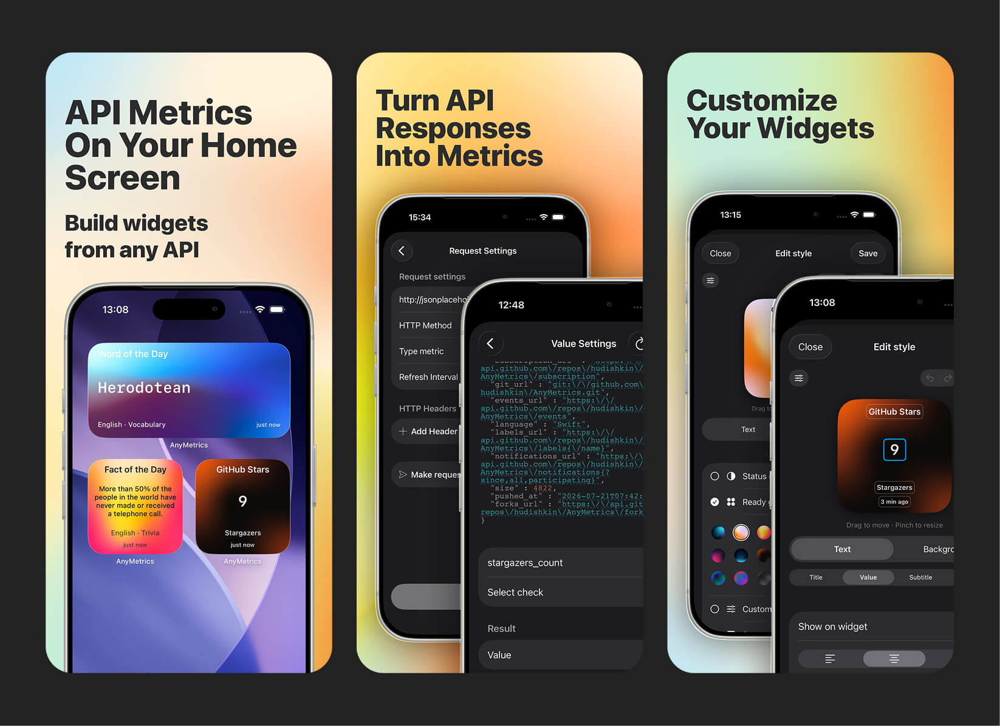

<p align="center">
  
</p>

<h1 align="center">AnyMetrics</h1>

<p align="center">
  <strong>Any HTTP endpoint → a live widget on your iPhone.</strong>
</p>

<p align="center">
  Point AnyMetrics at a REST API, JSON service, or web page.<br />
  Extract the value you care about. Pin it to your Home Screen.<br />
  No code. No ads.
</p>

<p align="center">
  <a href="https://apps.apple.com/us/app/anymetrics/id1609900961">
    
  </a>
</p>

<p align="center">
  
  
  
  <a href="LICENSE"></a>
  
</p>

---

## Why AnyMetrics?

Your APIs already know what’s happening — uptime, deploys, stars, downloads, CI status.  
AnyMetrics turns that into a glanceable Home Screen widget.

| Without AnyMetrics | With AnyMetrics |
|---|---|
| Open dashboards, refresh pages, dig through JSON | One number, always on your Home Screen |
| Custom scripts / scrapers / bots | Configure once in the app |
| Another SaaS to pay for | Free, open source, runs on-device |
| Hand your API keys to a third-party service | Keys stay on your iPhone — requests go straight to your endpoint |

---

## How it works

```
1. Request   →  URL, method, headers, body
2. Extract   →  JSON path, HTML selector, or HTTP status
3. Widget    →  Pin it to your Home or Lock Screen. It refreshes on schedule.
```

That’s it. Three steps from endpoint to widget.

---

## What people monitor

- Server uptime & API health
- CI/CD from GitHub, GitLab, Jenkins
- Response times, error rates, deploy status
- Download counts, repo stars, any JSON field
- Scraped values from public HTML pages

---

## Features

| | |
|---|---|
| **Custom HTTP** | `GET`, `POST`, `PUT`, `DELETE`, `HEAD` with custom headers and body |
| **JSON parsing** | Dot-paths with filters, aggregates, and selectors |
| **HTML parsing** | CSS selectors (`Document.querySelector` style) — returns the element's text |
| **Status checks** | Endpoint health at a glance: `2xx` = OK, or OK when the response equals / contains a value |
| **Refresh schedule** | Every 15 min, 30 min, 1, 3, 6 or 12 hours — or let iOS decide |
| **Widgets** | Home Screen (small, medium) and Lock Screen (circular, rectangular, inline) |
| **Widget design** | Glass, Card and Plain presets; custom background (color, gradient, photo), fonts, colors and layout |
| **Value formatting** | Currency, length trimming, and more |
| **Gallery** | Ready-made metrics from the [community](https://github.com/hudishkin/AnyMetricsGallery) — one tap to add |
| **AI generation** | Describe what you want to track; the assistant finds a public source and builds the metric. Needs sign-in (Apple, Google or GitHub); free attempts, then credits |
| **Share / Import / Export** | Share a metric as an image + JSON file; import metrics from teammates |
| **Languages** | English and Russian |

---

## Privacy

Your metrics and API keys stay on your iPhone — requests go straight to your endpoint, with no AnyMetrics server in between. The app sends anonymous usage events and crash reports, never your URLs, headers or values.

AI generation is the one feature that uses an AnyMetrics server. It receives your sign-in, the description you type and your answers — never your saved metrics or their keys. It is optional; everything else works without an account.

[What exactly is collected](ANALYTICS.md) · [Privacy Policy](privacy_policy.md)

---

## Parsing rules

### JSON

Navigate with a **dot-separated path**.

#### Basic navigation

```json
{
  "data": {
    "items": ["apple", "google", "facebook"]
  }
}
```

| Rule | Result | |
|---|---|---|
| `data.items.1` | `google` | Array index |
| `data.items.0` | `apple` | First element |

#### Aggregates

```json
{
  "users": [
    { "name": "Alice", "age": 25 },
    { "name": "Bob", "age": 30 },
    { "name": "Charlie", "age": 35 }
  ]
}
```

| Op | Meaning | Example | Result |
|---|---|---|---|
| `*+` | Sum | `users.*+.age` | `90` |
| `*avg` | Average | `users.*avg.age` | `30` |
| `*min` | Minimum | `users.*min.age` | `25` |
| `*max` | Maximum | `users.*max.age` | `35` |

#### Selectors

| Op | Meaning | Example | Result |
|---|---|---|---|
| `*first` | First element | `users.*first.name` | `Alice` |
| `*last` | Last element | `users.*last.name` | `Charlie` |
| `*count` | Count | `users.*count` | `3` |

#### Filters

Syntax: `*[field<op>value]`

```json
{
  "servers": [
    { "name": "s1", "status": "online", "cpu": 45 },
    { "name": "s2", "status": "offline", "cpu": 90 },
    { "name": "s3", "status": "online", "cpu": 72 }
  ]
}
```

| Op | Meaning | Example | Result |
|---|---|---|---|
| `=` | Equal | `servers.*[status=online].*count` | `2` |
| `!=` | Not equal | `servers.*[status!=offline].*count` | `2` |
| `>` | Greater | `servers.*[cpu>50].*count` | `2` |
| `<` | Less | `servers.*[cpu<80].*+.cpu` | `117` |
| `>=` | ≥ | `servers.*[cpu>=72].*avg.cpu` | `81` |
| `<=` | ≤ | `servers.*[cpu<=45].*first.name` | `s1` |

#### Chain them

Filters, selectors, and aggregates compose:

```text
servers.*[status=online].*avg.cpu   →  58
servers.*[cpu>50].*last.name        →  s3
servers.*[status=online].*max.cpu   →  72
```

### HTML

Same idea as `Document.querySelector(selector)`.

```text
div a.link
```

---

## FAQ

**How often does the widget update?**
You pick an interval (15 min – 12 h) or let iOS decide. iOS treats the interval as a request, not a guarantee: it may delay updates to save battery, especially when the phone is idle or in Low Power Mode. Open the app to refresh immediately.

**Does it work with plain `http://`?**
Yes, plain HTTP is allowed. Self-signed HTTPS certificates are not supported.

**Can I extract an HTML attribute (e.g. `href`)?**
Not yet — HTML rules return the text of the last matching element.

**Where are my API keys stored?**
Only on your device, together with the rest of the metric. See [Privacy & analytics](ANALYTICS.md).

---

## Contributing

- **Add a metric to the Gallery** — open a pull request in [AnyMetricsGallery](https://github.com/hudishkin/AnyMetricsGallery).
- **Report a bug or request a feature** — [open an issue](https://github.com/hudishkin/AnyMetrics/issues) or write to [anymetrics.app@gmail.com](mailto:anymetrics.app@gmail.com).
- **Code** — pull requests are welcome. See [Build from source](#build-from-source).

---

## Links

- [App Store](https://apps.apple.com/us/app/anymetrics/id1609900961)
- [Community Gallery](https://github.com/hudishkin/AnyMetricsGallery) — ready-made metrics from the community
- [Privacy Policy](privacy_policy.md)

---

## Build from source

**Requirements:** iOS 16.0+, Xcode 15+, [Tuist](https://tuist.io). The Tuist version is pinned in [`mise.toml`](mise.toml); with [mise](https://mise.jdx.dev) run `mise install`.

```bash
cp generate.example.sh generate.sh   # optional: your team, API and sign-in ids, ignored by git
./generate.sh                         # or: tuist install && tuist generate
```

Open the generated workspace in Xcode and run. Run unit tests with the `AnyMetrics` scheme (`AnyMetricsTests` target).

### Running a fork

Widgets, metrics and the Gallery work as is. A few things are tied to the AnyMetrics App Store app and need your own setup. The `TUIST_*` variables go into `generate.sh`:

| What | Where | Notes |
|---|---|---|
| Signing team | `TUIST_TEAM_ID` | Bundle id and App Group (`group.anymetrics.app`) are in [`Project.swift`](Project.swift) and the entitlements; change them for your team |
| Firebase | `AnyMetrics/GoogleService-Info.plist` | Replace with your project's file. Debug builds send no analytics |
| Builder API (AI generation) | `TUIST_BUILDER_API_URL` | Not in this repository. Contract: [docs/builder-api.md](docs/builder-api.md). Defaults to `http://127.0.0.1:3000`; Debug builds can switch servers in the Dev Menu |
| Sign in with Apple | Capability in `AnyMetrics.entitlements` | Needs a team that has it enabled |
| Sign in with Google | `TUIST_GOOGLE_CLIENT_ID` | Empty by default; the button reports "not set up" |
| Sign in with GitHub | `TUIST_GITHUB_CLIENT_ID` | Empty by default. Use your OAuth app with the `anymetrics://callback` redirect |
| Credits (StoreKit) | [`CreditProducts.swift`](AnyMetrics/Service/Store/CreditProducts.swift) | Products `app.anymetrics.credits.{5,15,40}` must exist in your App Store Connect and on your server |

---

## License

[MIT](LICENSE)
